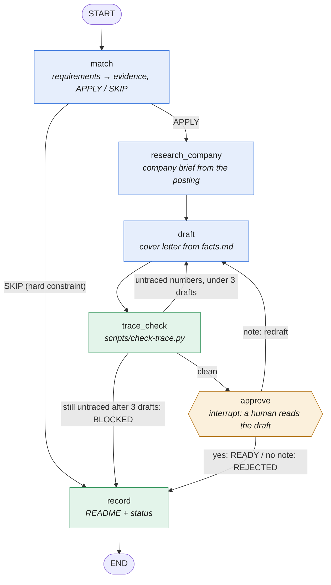

# apply-graph

The apply track of job-agent-skills (`/job-match` → `/make-resume` → `/job-apply`) as one [LangGraph](https://github.com/langchain-ai/langgraph) state graph, for one posting at a time.



Blue nodes call the model, green nodes are plain code, the amber node waits for a person. Every arrow is decided by code.

The skills ask the model to keep every claim traceable to `facts.md`. Here the control flow does not depend on the model:

- **The model only fills nodes.** `match` returns a typed requirement → evidence matrix and `APPLY`/`SKIP`; `research_company` returns a short company brief from the posting (APPLY path only); `draft` returns a cover letter. All three use Claude structured outputs (`messages.parse` with a Pydantic schema).
- **Edges are deterministic.** `trace_check` runs the repo's own `scripts/check-trace.py`; any number missing from `facts.md` sends the draft back with the exact claims, up to three drafts, then the run is recorded `BLOCKED` without bothering a human.
- **The human gate is a LangGraph `interrupt`.** Nothing is recorded until someone approves. A reply with a note loops back into `draft` with the note.
- **Runs survive the process.** The CLI checkpoints to SQLite (`SqliteSaver`), so you can stop at the approval prompt and resume later with the same thread id. A test proves a fresh graph resumes a parked run without calling the model again.

## Run

```bash
cd graph
uv venv && uv pip install -e ".[dev]"
uv run --no-project apply-graph --job career/<role>/03-Job-Description.md --facts career/facts.md --out career/<role>
```

Needs Anthropic credentials (`ANTHROPIC_API_KEY` or an `ant auth login` profile). Model: `claude-opus-5-5`.

No API key? Add `--backend claude-code` to call the model through the logged-in `claude` CLI instead.

## Web UI

```bash
uv run --no-project apply-graph-web --career ../../career        # http://127.0.0.1:5181
```

Pick a posting and watch each node finish live (FastAPI streams `graph.stream` over SSE), then approve, send the draft back with a note, or reject it at the interrupt. Runs go to `career/_graph-runs/<run id>/` with one SQLite checkpoint file, so a run parked at approval survives a server restart and reopens from the runs list. Defaults to the `claude-code` backend.

Each SSE event pairs the `updates` chunk (which node finished) with the `checkpoints` chunk that follows it (state with that node applied, plus `next`). Calling `get_state()` at the update instead returns the state one step behind, because the checkpoint is saved after the update is emitted.

## Step history

```bash
uv run --no-project apply-graph-history --db ../../career/_graph-runs/.graph.sqlite --thread <run id> [--field draft]
```

Reads a finished or parked run back with `get_state_history` and prints, oldest first, which node ran at each step and which state fields it changed, with each step's `checkpoint_id` (pass that in `config["configurable"]` to read or fork the run from that point). `--field` keeps only the steps that changed one field and shows its value. Checkpoints don't record who wrote them, so the node is taken from the previous checkpoint's `next`. Nothing runs and no model is called.

## Test

```bash
uv run --no-project pytest
```

Tests drive every path (approve, trace retry, give up, skip, human redraft, reject, SQLite resume, step history) and the web API (node-by-node SSE, resume over HTTP, bad input) on a scripted fake model against the fictional eval persona in `evals/_fixtures/career/`. No network, no API key.

## Layout

| File | What |
|---|---|
| `apply_graph/state.py` | `ApplyState` TypedDict (with an `operator.add` reducer for the run log) and the Pydantic output schemas |
| `apply_graph/graph.py` | Nodes, routing functions, `build_graph(llm, checkpointer)` |
| `apply_graph/llm.py` | `LLM` protocol and the Claude implementation |
| `apply_graph/trace.py` | Loads `scripts/check-trace.py` so the graph and the CLI gate are the same code |
| `apply_graph/cli.py` | Interactive runner with SQLite checkpoints |
| `apply_graph/web.py`, `static/index.html` | FastAPI + SSE server and the single-page UI |
| `apply_graph/history.py` | `changes(graph, config)` and the `apply-graph-history` command |
